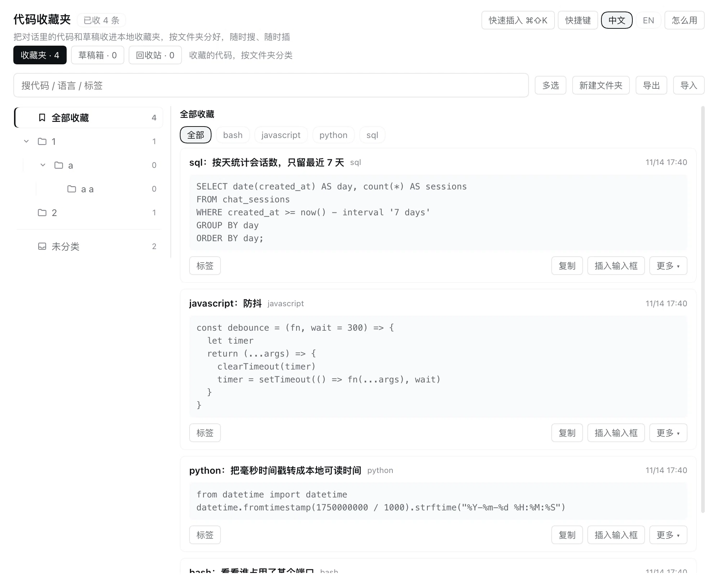
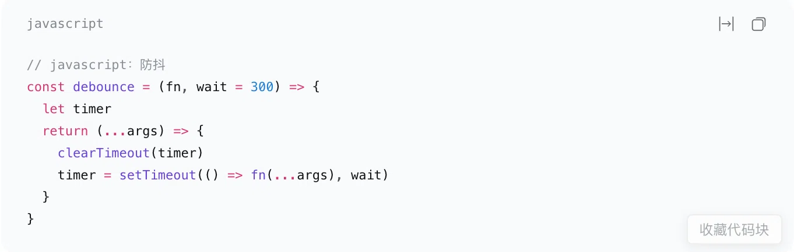

# 代码收藏夹 · dsh-code-vault

把对话里出现的代码块收进一个本地收藏夹，把写到一半的输入框内容收进单独的草稿箱，再用文件夹像电脑目录一样分级整理——全部在 DSH 左侧栏的面板里完成：搜索、打标签、多选批量、合并成新条目，或者一键插回输入框继续改。赶时间时按 `⌘⇧K`（Windows/Linux 为 `Ctrl+Shift+K`）随时唤起快速插入。





## 它做什么

- **对话里收藏**：每个 markdown 代码块右下角有一个「收藏代码块」按钮（常驻显示，不用悬停）。点一下收藏，按钮变成「已收藏 ✓」；再点一下取消收藏，手滑了也不怕。
- **侧栏面板**：左侧栏的书签图标打开「代码收藏夹」，按内容 / 语言 / 标签搜索，也可以改标签、复制、删除。
- **多选与批量**：点面板工具栏的「多选」，卡片变成可勾选的复选框，可以批量复制、批量加标签、批量删除（删除前有二次确认）。
- **合并为新条目**：选中 2 条以上点「合并为新条目」，按列表顺序整合成一条 markdown（每块带 `### 标题` 与小标题围栏），标题可改、可先看预览，确认后才写入。
- **插回输入框**：面板里的「插入输入框」会把代码放回对话输入框，直接接着改（一次 undo 可撤销）。
- **快速插入 `⌘⇧K`**：在界面上任何地方按 `⌘⇧K`（Windows/Linux 为 `Ctrl+Shift+K`）唤起浮层，输入即搜，`↑↓` 选、`Enter` 插入、`Esc` 关闭——不用离开对话去开侧栏。
- **两条车道**：面板顶部是「收藏夹」和「草稿箱」两个页签。代码块永远进收藏夹；输入框里的半成品进草稿箱，两者不会互相污染。
- **存草稿**：输入框里有内容时，卡片下方会出现「存草稿」，把写到一半的提示词收进草稿箱；草稿可以随时「移入收藏夹」，并直接选好落到哪个文件夹。
- **文件夹分级**：左侧目录树支持无限层级（上限 200 个文件夹）：新建、重命名、删除都不会丢内容——删掉一个文件夹，里面的文件夹和条目自动上移到上一层，并弹确认框说明这一点。
- **拖动整理**：卡片可以直接拖到左侧任意文件夹上；也可以在卡片「更多 ▾」里选「移动到…」，用对话框挑文件夹（含「未分类」）。面板顶部面包屑会显示当前路径。
- **带检查的编辑器**：点卡片「更多 ▾ → 编辑」改标题或代码：行号、括号与引号自动配对、`Enter` 自动缩进、`Tab` 缩进、`⌘S` 保存；同时实时提示括号没配对 / JSON 无效 / JS 语法错误 / 行尾空格，点一行就跳过去；提示可以「展开全部」，窗口右下角还能上下拖动调高度。
- **导出 / 导入**：JSON 备份，换机器时搬过去。

数据只存在当前浏览器的 `localStorage` 里，不联网、不上传，也不跨设备同步。

## 更新日志

每个版本的改动见 [CHANGELOG.md](CHANGELOG.md)。

## 安装

从 DSH 插件市场安装，或者在 **Plugins → Add plugin** 里填 GitHub 地址：

```
github:Souffle-78/dsh-code-vault
```

命令行等价写法（`--profile` 换成你自己的 profile）：

```sh
dsh plugin --profile desktop add github:Souffle-78/dsh-code-vault
```

安装后刷新页面（或重启 DSH），左侧栏会出现书签图标。

从源码目录本地安装也可以：**Plugins → Add plugin** 选择克隆下来的仓库根目录。

## 使用（三步）

1. 在对话里点代码块右下角的「收藏代码块」。
2. 点左侧栏书签图标打开面板。
3. 搜索 / 打标签 / 复制，或点「插入输入框」；想整理就新建文件夹（可以套子文件夹）、把卡片拖进去，或者用「更多 ▾ → 移动到…」。

草稿箱单独一条：输入框写到一半点「存草稿」→ 面板切到「草稿箱」→ 需要时点「移入收藏夹」并选文件夹。

赶时间的两条捷径：

- 按 `⌘⇧K`（Windows/Linux `Ctrl+Shift+K`）在任何界面唤起快速插入浮层，用键盘挑一条直接插进输入框。
- 输入框写到一半时点下方的「存草稿」，草稿会作为一条 `text` 类型的收藏存下来。

面板右上角可以在中文和 English 之间切换，与 DSH 界面语言相互独立。

## 已知限制

- 收藏的是 markdown 代码块和输入框草稿，普通回答文本整段收藏还不支持。
- 单浏览器 `localStorage`，上限 400 条（收藏 + 草稿合计）、200 个文件夹，单条最多 200 000 字符。
- 草稿只出现在「草稿箱」页签，不参与代码块的「已收藏」判断，也不会出现在 `⌘⇧K` 快速插入列表里。
- `diff` / `math` / `patch` / `mermaid` 这类特殊代码块不显示收藏按钮；正在流式输出（`streaming`）的代码块也不显示。
- 换浏览器或换机器不会带上收藏，请用面板里的「导出 / 导入」。
- 合并出的新条目语言记为 `markdown`：各段的原语言写在围栏上，回插输入框后仍是完整可读的多段代码。
- 合并结果超过单条上限（200 000 字符）时，确认按钮会禁用并提示，不会写坏存储。

## 开发

- `client.js` 是全部 UI：一个 `window.__ModuleLoader__.load({ id, factory })` 的 lazy factory，`require('react')` 从宿主模块表取，不打包 React。
- `index.js` 是空的 host 半边（这是纯前端插件）。
- `cordis.patch.yml` 声明 bundle 里的插件行；`package.json` 的 `dsh.bundle` 是市场收录与 `dsh plugin add` 安装必需的那一项。
- 改完客户端代码后要刷新页面（客户端模块在启动时加载）。

## 许可

MIT
