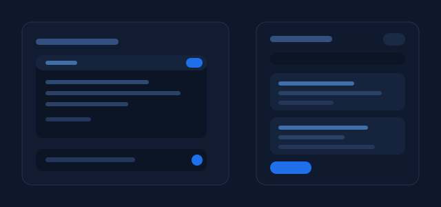

# Code Vault

Keep the code that shows up in a conversation — a shell command, a config file, a snippet worth reusing — instead of scrolling back to find it.

## How to use it

1. In any conversation, a code block carries a **Save to vault** button in its bottom-right corner (always visible, no hovering required).
2. Click it. The button turns into **Saved ✓**; the block is stored in this browser only — nothing is uploaded. Click the same button again to remove it, so a slip of the mouse stays harmless.
3. Open the bookmark icon in the left sidebar. The panel lists everything saved: search by code, language or tag, add tags, copy, delete, export/import JSON, or **Insert** to put the block back into the composer and keep editing.

## Notes

- Storage is per browser profile (`localStorage`), capped at 400 entries; one entry holds up to 200 000 characters.
- Saving the same code twice does not create a duplicate; an already saved block keeps showing **Saved ✓** long after the reply, including after a reload.
- The panel can switch between 中文 and English independently of the DSH UI language.
